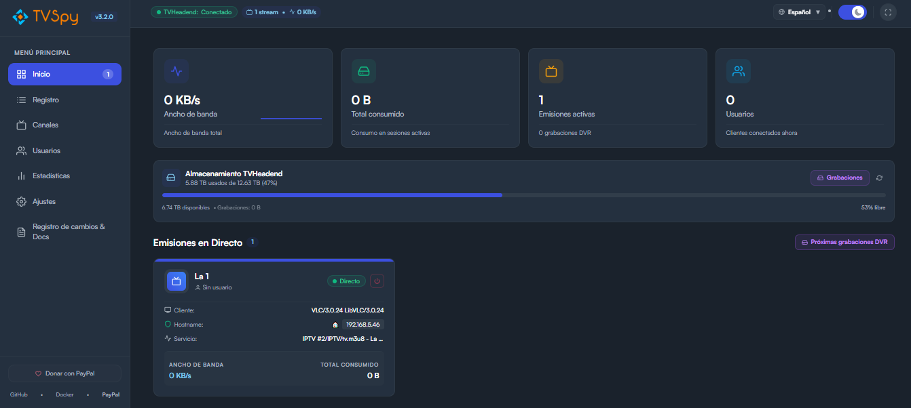
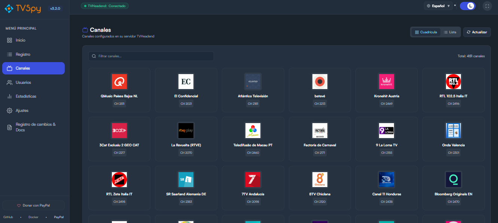
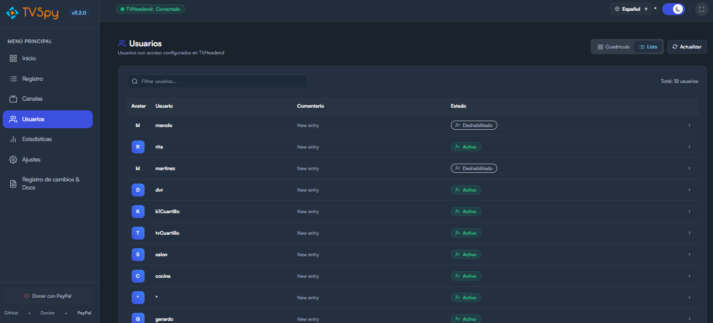
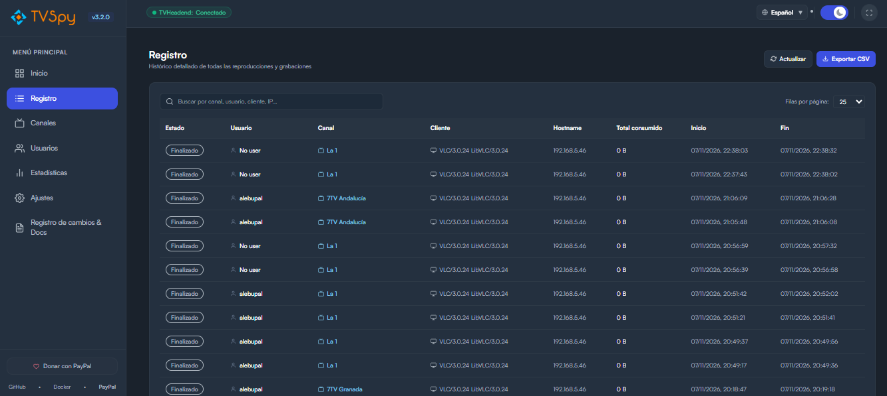
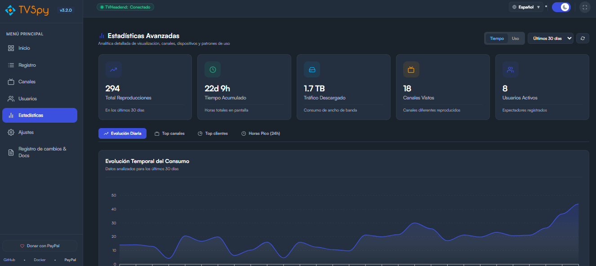
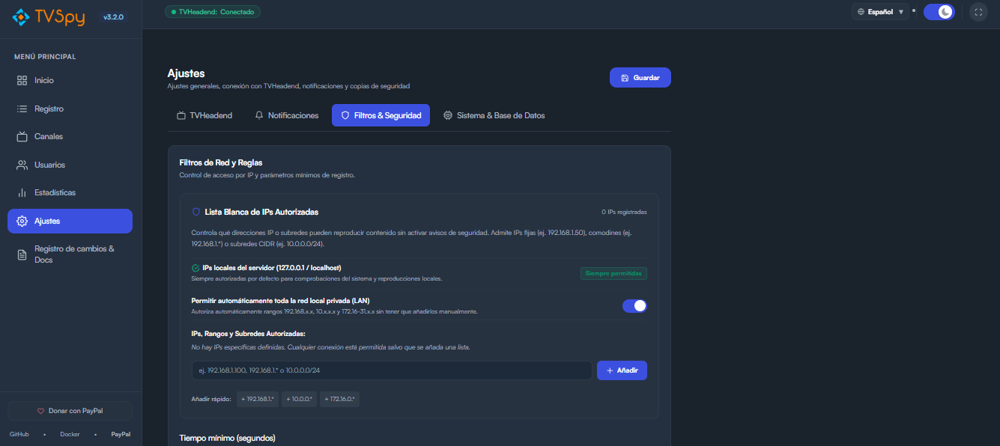

# TVSPY 📺

[](https://github.com/alebupal/tvspy/releases)
[](https://hub.docker.com/r/alebupal/tvspy/)
[](https://opensource.org/licenses/ISC)
[](https://www.paypal.me/alebupal)
[](https://t.me/tvspy_news)

**TVSPY** is a modern, fast, and responsive web application designed to monitor **TVHeadend** servers in real time. Effortlessly supervise live broadcasts, DVR recordings, real-time bandwidth consumption, active viewers, playback history, and advanced analytics.

---

## ✨ Key Features

- 📡 **Real-time Live Stream Monitoring**:
  - Displays real channel logos with graceful fallbacks.
  - **Live EPG in Stream Cards**: Shows currently broadcasting program title, summary, progress bar, and remaining minutes.
  - Who is online, what channel they are watching, client player (VLC, Kodi, TiviMate, etc.), and instant bitrate pulse via WebSockets.
  - **Kill Stream**: Remote stream termination button directly stopping playbacks via TVHeadend API.
  - **Signal Health**: Real-time error packet counter and transport stream degradation warning.
  - **Bandwidth Sparklines**: Live chart showing bitrate fluctuations per session.
  - **GeoIP & Local IP Recognition**: Country flags and automatic local area network (LAN) detection.
  - **Smart Scan Filtering**: Automatically filters out internal TVHeadend IPTV/M3U mux scans and EPG grabber tasks.
- 💾 **TVHeadend Storage & Disk Space Monitor**:
  - Real-time disk capacity, free space, and used space metrics queried directly from TVHeadend `/comet/poll` and WebSocket events.
  - Color-coded progress bar with low-space alerts (< 10%).
  - DVR recording storage utilization breakdown.
- 🔴 **DVR Recording Detection & Upcoming Schedules**:
  - Clear visual distinction between live streaming and scheduled recordings with dynamic badges.
  - **Upcoming DVR Recordings Modal**: Inspect all scheduled timers and automated series recordings in TVHeadend with countdowns.
- 🔔 **Multi-Platform Notifications & Web Audio Alerts**:
  - **Unified Notifications Center** in Settings grouping all alert mechanisms.
  - **Browser Desktop Notifications & Sound Chimes**: Native OS notification banners and synthesized two-tone chimes (Web Audio API) when new playbacks start or unauthorized IPs connect.
  - **Telegram**, **Discord** (Rich Embeds), **Gotify**, and custom **HTTP POST Webhooks**.
  - Notifications on playback/recording start, stop, extended viewing limits, unauthorized IP access, and TVHeadend server disconnection/recovery.
- 📺 **Dual Views & In-Depth Analytics for Channels & Users**:
  - Switch between **Grid** and **Detailed Table / List** views in both Channels and Users sections with persistent preference.
  - **Channel Profile Modal**: Detailed statistics (total plays, accumulated duration, bytes downloaded, unique viewers, top viewers, and recent logs).
  - **User Profile Modal**: Viewer statistics, top watched channels, total streaming time, and activity history.
- 📊 **Advanced Analytics & Charts Dashboard**:
  - **Timeline Trend** chart (daily hours or playback counts).
  - **Top Channels** ranking.
  - **Client / Device Distribution** chart.
  - **Peak Hours** analysis (24-hour usage distribution).
  - Flexible filters by date range (7, 14, 30, 90 days, or full year) and metric (time vs uses).
- 🔒 **Security & Access Control**:
  - **PIN Lock Screen**: Secure your TVSpy panel with a custom numeric PIN, dynamic digits, and physical keyboard support.
  - **Interactive IP Whitelist**: Manage authorized IPs with interactive tags/chips, quick presets, wildcard (`192.168.1.*`), and CIDR subnet (`10.0.0.0/24`) support.
  - **Local Server & LAN Protection**: Loopback connections (`127.0.0.1`, `localhost`, `::1`) are always permitted by default, with optional one-click auto-authorization for all private LANs.
- 🔄 **Server Health, Reliability & Maintenance**:
  - **Heartbeat Monitor**: Detects TVHeadend connection drops (> 2 min) and sends automatic alerts and recovery notices.
  - **Scheduled Auto-Purge**: Background scheduler with configurable retention days and automatic SQLite database `VACUUM`.
  - **Direct Backup**: Download `.db` database copies with one click.
  - **Hot Reconnection**: Updating credentials in Settings triggers an immediate hot reconnection **without needing to restart the container**.
- 🌓 **Fullscreen / Kiosk Mode**, Dark/Light Theme, GitHub Version Checker, and complete **Spanish / English** translations.

---

## 📸 Screenshots

| Live Dashboard & Storage | Channels View |
| :---: | :---: |
|  |  |

| Users & Activity | Streaming History |
| :---: | :---: |
|  |  |

| Analytics & Trends | Unified Settings |
| :---: | :---: |
|  |  |

---

## 🚀 Docker Deployment

### Option 1: Docker Compose (Recommended)

Create a `docker-compose.yml` file:

```yaml
services:
  tvspy:
    image: alebupal/tvspy:latest
    container_name: tvspy
    restart: unless-stopped
    ports:
      - "80:80"
    volumes:
      - ./tvspy_data:/app/backend/src/database/file
    environment:
      - TZ=Europe/Madrid
      - LOCALE=es-ES
```

Start the container:
```bash
docker compose up -d
```

### Option 2: Docker CLI

```bash
docker run -d \
  --name=tvspy \
  --restart=unless-stopped \
  -p 80:80 \
  -v /path/to/data:/app/backend/src/database/file \
  -e TZ=Europe/Madrid \
  -e LOCALE=es-ES \
  alebupal/tvspy:latest
```

Once running, navigate to `http://YOUR_SERVER_IP:80` and head over to the **Settings** section to configure your TVHeadend IP, port, and credentials.

---

## 🛠️ Local Development

TVSPY includes a unified runner to launch both Backend and Frontend concurrently with a single command:

```bash
# 1. Clone the repository
git clone https://github.com/alebupal/tvspy.git
cd tvspy

# 2. Install all dependencies
npm run install:all

# 3. Launch Backend (port 3001) and Frontend (port 5173) concurrently
npm run dev
```

### Individual commands:
- `npm run dev:backend` - Starts only the backend with nodemon.
- `npm run dev:frontend` - Starts only the frontend with Vite.
- `npm run build` - Builds the frontend for production.

---

## ⚙️ Environment Variables

| Variable | Description | Default |
| :--- | :--- | :--- |
| `TZ` | Container timezone | `Europe/Madrid` |
| `LOCALE` | Locale for dates and numbers | `es-ES` |
| `PORT` | Internal Node.js backend port | `3001` |

---

## 🤝 Support & Donations

If TVSPY is useful to you and you wish to support its ongoing development:

- ☕ **Donate via PayPal**: [paypal.me/alebupal](https://www.paypal.me/alebupal)
- 📢 **Telegram News Channel**: [@tvspy_news](https://t.me/tvspy_news)
- 🐛 **Report Issues**: [GitHub Issues](https://github.com/alebupal/tvspy/issues)

---

## 📄 License

This project is licensed under the **ISC** License. See the `LICENSE` file for details.
