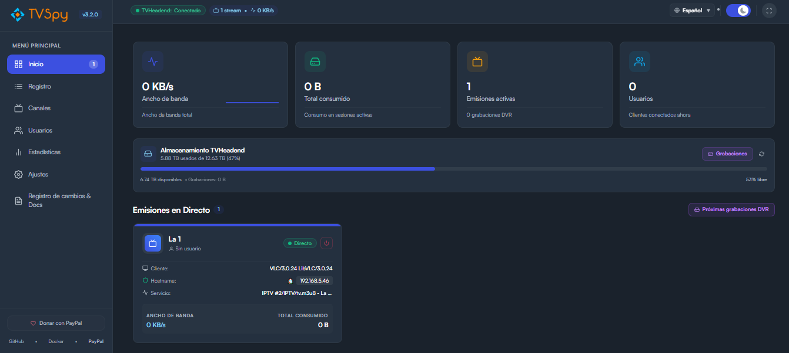
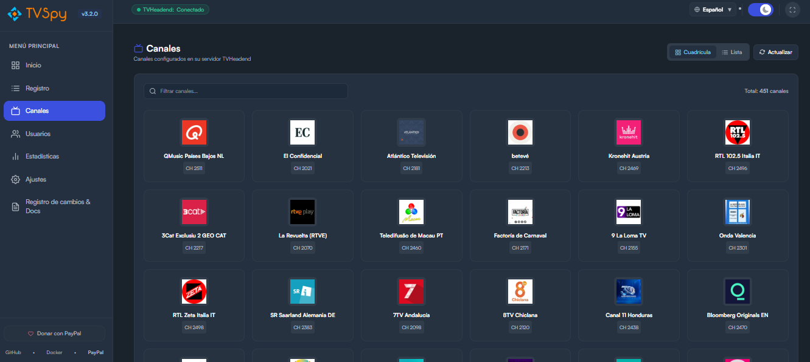
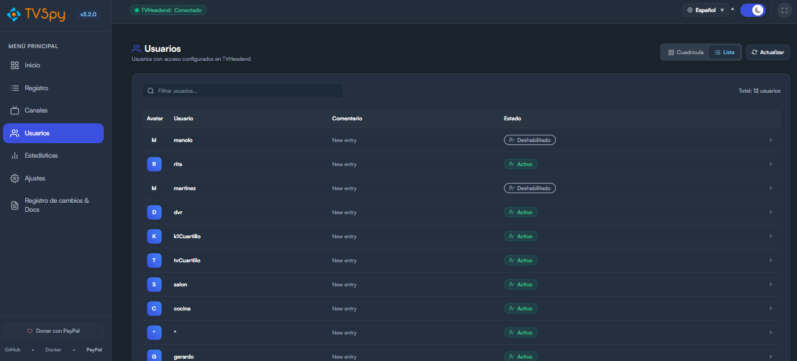
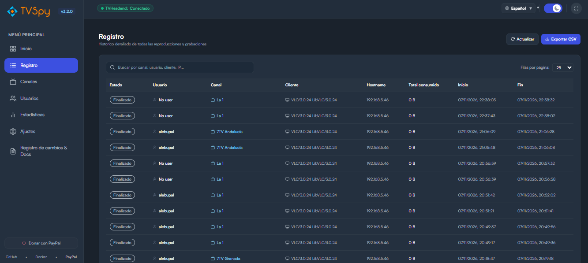
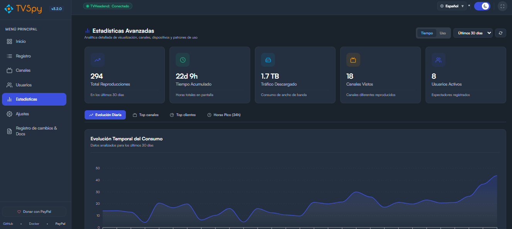
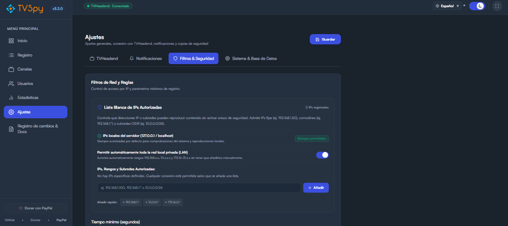

# TVSPY 📺

[](https://github.com/alebupal/tvspy/releases)
[](https://hub.docker.com/r/alebupal/tvspy/)
[](https://opensource.org/licenses/ISC)
[](https://www.paypal.me/alebupal)
[](https://t.me/tvspy_news)

**TVSPY** es una suite moderna, rápida, accesible y responsive diseñada para monitorizar servidores **TVHeadend** en tiempo real. Permite supervisar transmisiones en directo, grabaciones programadas DVR, ancho de banda instantáneo, usuarios conectados, histórico de sesiones y análisis estadístico en profundidad.

---

## ✨ Características Principales

- 📡 **Monitoreo en Tiempo Real de Emisiones en Directo**:
  - Logotipos oficiales de canales con renderizado proporcional y fallback automático.
  - **EPG en Vivo en Tarjetas**: Muestra el título del programa en emisión, sinopsis, barra de progreso y minutos restantes.
  - Usuarios conectados, canal sintonizado, cliente/reproductor utilizado (VLC, Kodi, TiviMate, etc.) y tasa de bits instantánea mediante WebSockets nativos.
  - **Kill Stream**: Botón de detención remota para cancelar cualquier emisión activa directamente a través de la API de TVHeadend.
  - **Salud de Señal**: Contador de paquetes con error y aviso de degradación de transporte de flujo.
  - **Sparklines de Ancho de Banda**: Gráficas dinámicas de consumo por sesión en tiempo real.
  - **Geolocalización e IPs Locales**: Detección de país con banderas e identificación automática de red local (LAN).
  - **Filtro Inteligente de Escaneos**: Descarta automáticamente tareas internas de TVHeadend como escaneos de listas M3U/IPTV, muxes y grabadores EPG.
- 💾 **Monitor de Almacenamiento y Espacio en Disco de TVHeadend**:
  - Lectura en tiempo real de capacidad total, espacio libre y ocupado consultando directamente `/comet/poll` y eventos WebSocket de TVHeadend.
  - Barra de progreso coloreada con alerta de espacio bajo (< 10%).
  - Métrica de espacio consumido específicamente por las grabaciones del DVR.
- 🔴 **Detección de Grabaciones DVR y Modal de Próximas Emisiones**:
  - Diferenciación visual clara entre streaming en directo y grabaciones activas con insignias distintivas.
  - **Modal de Próximas Grabaciones DVR**: Visualiza los temporizadores y series programadas en TVHeadend con cuenta atrás y detalles.
- 🔔 **Centro de Notificaciones Multiplataforma y Sonidos Web Audio**:
  - **Centro Unificado de Notificaciones** en Ajustes que agrupa todos los mecanismos de aviso.
  - **Avisos de Escritorio y Timbres Sonoros**: Banners nativos del navegador y tono acústico de dos notas sintetizado en tiempo real (Web Audio API) ante nuevas emisiones o IPs no autorizadas.
  - Integración nativa con **Telegram**, **Discord** (Rich Embeds), **Gotify** y **Webhooks HTTP POST**.
  - Alertas automáticas por inicio/fin de reproducción, grabación, límites de tiempo, accesos no autorizados y desconexión/recuperación del servidor.
- 📺 **Vistas Duales y Estadísticas para Canales y Usuarios**:
  - Selector de vista en **Cuadrícula** y **Tabla Detallada Compacta** tanto en Canales como en Usuarios con preferencia persistente.
  - **Modal de Perfil de Canal**: Estadísticas agregadas completas (reproducciones totales, tiempo acumulado, tráfico descargado, espectadores únicos, top usuarios y registros recientes).
  - **Modal de Perfil de Usuario**: Horas de visualización, canales preferidos y registro individual de actividad.
- 📊 **Panel Analítico y Estadísticas Avanzadas**:
  - Gráfico de **Evolución Temporal** (consumo diario de horas/reproducciones).
  - Ranking de **Top Canales más vistos**.
  - Distribución de **Clientes y Reproductores**.
  - Análisis de **Horas Pico** (distribución de uso de 00:00 a 23:00).
  - Filtros interactivos por rango de fechas (7, 14, 30, 90 días o 1 año) y métrica (tiempo vs usos).
- 🔒 **Seguridad y Control de Acceso**:
  - **Bloqueo por Código PIN**: Protege el acceso al panel con un PIN numérico personalizable, soporte de teclado físico y arranque protegido sin fugas visuales.
  - **Gestor Interactivo de IPs Autorizadas**: Lista blanca mediante etiquetas/chips con presets rápidos y compatibilidad completa con comodines (`192.168.1.*`) y subredes CIDR (`10.0.0.0/24`).
  - **Protección de IPs Locales y del Servidor**: Conexiones locales del servidor (`127.0.0.1`, `localhost`, `::1`) permitidas siempre por defecto, con opción para autorizar toda la LAN privada con un solo clic.
- 🔄 **Resiliencia, Salud y Mantenimiento del Servidor**:
  - **Detector Heartbeat**: Supervisa la conexión con TVHeadend (> 2 min) y emite notificaciones de caída y recuperación.
  - **Auto-Purgado Periódico**: Limpieza automática en segundo plano de registros antiguos según los días configurados con compactación `VACUUM` en SQLite.
  - **Copia de Seguridad Directa**: Descarga con un solo clic del archivo `.db` de la base de datos desde Ajustes.
  - **Reconexión en Caliente**: Los cambios de credenciales en Ajustes reconectan al instante **sin necesidad de reiniciar el contenedor Docker**.
- 🌓 **Modo Kiosco / Pantalla Completa**, Modo Oscuro/Claro, Comprobador de Actualizaciones desde GitHub y soporte multilingüe completo (**Español** e **Inglés**).

---

## 📸 Capturas de Pantalla

| Panel en Vivo y Almacenamiento | Vista de Canales |
| :---: | :---: |
|  |  |

| Usuarios y Actividad | Historial de Emisiones |
| :---: | :---: |
|  |  |

| Analítica y Tendencias | Ajustes Unificados |
| :---: | :---: |
|  |  |

---

## 🚀 Despliegue con Docker

### Opción 1: Docker Compose (Recomendado)

Crea un archivo `docker-compose.yml`:

```yaml
services:
  tvspy:
    image: alebupal/tvspy:latest
    container_name: tvspy
    restart: unless-stopped
    ports:
      - "80:80"
    volumes:
      - ./tvspy_data:/app/backend/src/database/file
    environment:
      - TZ=Europe/Madrid
      - LOCALE=es-ES
```

Inicia el servicio:
```bash
docker compose up -d
```

### Opción 2: Docker CLI

```bash
docker run -d \
  --name=tvspy \
  --restart=unless-stopped \
  -p 80:80 \
  -v /ruta/a/datos:/app/backend/src/database/file \
  -e TZ=Europe/Madrid \
  -e LOCALE=es-ES \
  alebupal/tvspy:latest
```

Una vez desplegado, accede a `http://TU_IP:80` y dirígete al menú de **Ajustes** para configurar la IP, puerto y credenciales de tu TVHeadend.

---

## 🛠️ Desarrollo Local

TVSPY incluye un ejecutor unificado para arrancar tanto el Backend como el Frontend con un solo comando:

```bash
# 1. Clonar el repositorio
git clone https://github.com/alebupal/tvspy.git
cd tvspy

# 2. Instalar todas las dependencias
npm run install:all

# 3. Iniciar Backend (3001) y Frontend (5173) en simultáneo
npm run dev
```

### Comandos individuales:
- `npm run dev:backend` - Inicia sólo el backend con nodemon.
- `npm run dev:frontend` - Inicia sólo el frontend con Vite.
- `npm run build` - Compila el frontend para producción.

---

## ⚙️ Variables de Entorno

| Variable | Descripción | Valor por defecto |
| :--- | :--- | :--- |
| `TZ` | Zona horaria del contenedor | `Europe/Madrid` |
| `LOCALE` | Configuración regional para fechas y números | `es-ES` |
| `PORT` | Puerto interno del backend de Node.js | `3001` |

---

## 🤝 Soporte y Donaciones

Si TVSPY te resulta útil y deseas apoyar su desarrollo continuo:

- ☕ **Donar en PayPal**: [paypal.me/alebupal](https://www.paypal.me/alebupal)
- 📢 **Canal de Noticias en Telegram**: [@tvspy_news](https://t.me/tvspy_news)
- 🐛 **Reportar problemas**: [GitHub Issues](https://github.com/alebupal/tvspy/issues)

---

## 📄 Licencia

Este proyecto está bajo la Licencia **ISC**. Consulta el archivo `LICENSE` para más información.
